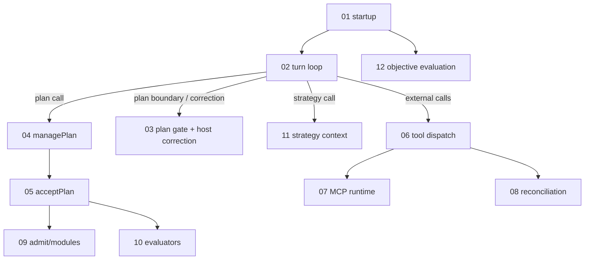

# GRODT Function-Path Sequence Diagrams

PlantUML sequence diagrams mapping each function path in the grodt agent runtime.
Each diagram is kept small enough to read; arrows labeled `-> NN-*.puml` continue
the path in another file. Line references are to the source at diagram-creation time.

> **Status note (planning removal):** the procedural planning subsystem was removed
> from `internal/loop` (MVP-first inversion). Diagrams **02 (plan branches), 03, 04,
> 05, 08, 10** document the removed plan gate / managePlan / acceptPlan /
> reconciliation / evaluator paths and are retained as historical reference only.
> The state-layer `Plan` type remains dormant (nil) so persisted snapshots and wasm
> contracts survive.

## Diagram map

| File | Covers | Entry point |
|------|--------|-------------|
| [01-startup.puml](01-startup.puml) | Process startup, config, store, provider wiring, cycle loop | `main` (cmd/grodt/main.go:33) |
| [02-toolprovider-turn.puml](02-toolprovider-turn.puml) | ToolProvider.Handle turn loop and response routing | `ToolProvider.Handle` (internal/loop/tools.go:68) |
| [03-plan-gate.puml](03-plan-gate.puml) | Plan-boundary gate, actor-plan capture, exclusive host-correction loop | tools.go:120, host_correction.go |
| [04-manageplan.puml](04-manageplan.puml) | managePlan actions (patch/revise/create_child/complete_child/abandon_child) | `managePlan` (internal/loop/planning.go:42) |
| [05-acceptplan.puml](05-acceptplan.puml) | acceptPlan -> intent validation -> evaluator -> store persistence (incl. PlanningDisabled kill-switch) | `acceptPlan` (planning.go:193) |
| [06-tool-dispatch.puml](06-tool-dispatch.puml) | Batch dispatch: queue/activate/invoke/record/admit/finish + recovery | tools.go:450-579 |
| [07-mcp-runtime.puml](07-mcp-runtime.puml) | MCP Runtime Preflight + Invoke: schema validation, wire capture, failure classification | `Runtime.Invoke` (internal/mcp/client.go:280) |
| [08-reconciliation.puml](08-reconciliation.puml) | Post-batch procedural reconciliation loop + checkpoint repair | `reconcile` (internal/loop/reconciliation.go:260) |
| [09-admit-modules.puml](09-admit-modules.puml) | Store.admit -> wasm module reducer -> mutation apply/validate -> host requests | `Store.Admit` (internal/state/store.go:220) |
| [10-evaluators.puml](10-evaluators.puml) | LLM evaluators: actorPlanCapture, validatePlanIntent, completion, structured.Generate, openai client | plan_intent.go, structured.go |
| [11-strategy-context.puml](11-strategy-context.puml) | grodt_manage_strategy_context host tool path | `manageStrategyContext` (strategy_context.go:330) |
| [12-objective-evaluation.puml](12-objective-evaluation.puml) | Cycle-level goal evaluation + completion bookkeeping | `evaluate` (cmd/grodt/objective.go:29) |

## Top-level flow

Render locally: `java -jar plantuml.jar design/*.puml -tsvg -o <dir>`
